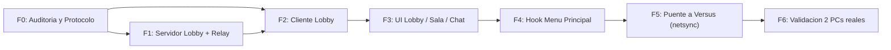

# Plan de trabajo: Modo Online Nativo e Intuitivo (1 vs 1)

## Objetivo
Implementar un modo Online accesible directamente desde el menú principal de BAG2JP, con:
- **Lobby** de salas 1 vs 1 (`Waiting` / `Playing`, `1/2` o `2/2`, crear/unirse/actualizar).
- **Sala 1 vs 1** con nombre del Host (dueño) y del Guest (invitado).
- **Control de inicio**: el dueño solo puede pulsar `Start` cuando el invitado marca `Ready`.
- **Chat** dentro de la sala.
- **Integración** con el transporte/sincronización existente (`bag2jp.feature.netsync` y netplay del framework).

---

## Fases y entregables

### Fase 0: Auditoría técnica y diseño de protocolo *(COMPLETADA)*
- **Hallazgos en `mods-src/bag2jp.feature.netsync/src/bag2jp_netsync.c`**:
  - Ya implementa transportes `NS_LAN`, `NS_INTERNET` (MQTT broker + STUN + UDP hole punching + relay), `NS_DIRECT` y `NS_LOOPBACK`.
  - Ya incluye `host_overlay.h` y `host_osd.h` para UI en overlay del framework.
  - Ya expone `bag2jp_bag1_content_id()` para verificar identidad de contenido (`M_CONTENT`), `M_PAD` para menús, `M_STEP` para pasos y `M_READY` para barrera de inicio.
  - Usa un `s_code` (room code) leído de `bag2jp_online.txt` para emparejar dos peers.
- **Decisión de arquitectura**: el Lobby/Sala no reemplaza a `netsync`; gestiona salas, chat y `Ready`/`Start`, y al iniciar la partida entrega un `room_code` único + transporte (`NS_INTERNET` o `NS_LAN`) a `bag2jp_netsync`.
- **Protocolo del Servidor de Lobby (JSON sobre WebSocket/TCP)**:
  - Cliente -> Servidor: `list_rooms`, `create_room {room_name, player_name, content_id}`, `join_room {room_id, player_name, content_id}`, `leave_room`, `set_ready {ready: bool}`, `chat_msg {text}`, `start_match`.
  - Servidor -> Cliente: `room_list {rooms[]}`, `room_state {room_id, room_name, host_name, guest_name, guest_ready, state}`, `chat_msg {sender, text, ts}`, `match_start {room_code, transport}`, `error {code, msg}`.
  - Regla de servidor: `start_match` solo se acepta si quien lo envía es el Host, hay Guest conectado, `guest_ready == true` y `host.content_id == guest.content_id`.

### Fase 1: Servidor de Lobby + Relay 1 vs 1
- Implementar servidor ligero para gestionar salas 1 vs 1, estados (`Waiting`, `Ready`, `Playing`), chat de sala y validación de fingerprint entre Host y Guest.
- Incluir soporte de **relay** (o señalización) para conexión entre dos PCs reales detrás de NAT.
- **Aceptación**: pruebas automatizadas de host (crear sala, unir segundo cliente, chat, bloqueo de `Start` sin `Ready`, `Start` con `Ready`).

### Fase 2: Cliente de Lobby en el proyecto
- Implementar cliente de red en C/C++ (conexión al servidor de lobby, heartbeat, manejo de eventos de sala y chat) integrado como módulo/mod.
- **Aceptación**: dos instancias locales conectadas al servidor intercambian estado de sala y chat por consola/log.

### Fase 3: UI de Lobby, Sala 1 vs 1 y Chat (Overlay)
- Implementar pantallas en overlay del framework (ImGui/SDL):
  - **Lobby**: lista de salas, estado, botón `Crear sala`, `Unirse`, `Actualizar`.
  - **Sala 1 vs 1**: slots Host/Guest, botón `Ready` (Guest), botón `Start` (Host, bloqueado hasta `Ready`), caja de **Chat**.
- **Aceptación**: navegación completa con mando/teclado, entrada de texto funcional en chat y **validación visual grabada en `BAG2JP-exp-8mb`** mostrando Lobby, Sala 1v1, `Ready`/`Start` y Chat en pantalla.

### Fase 4: Hook en Menú Principal
- Añadir opción **Online** en el menú principal del juego que abra directamente el Lobby y permita volver al menú al salir.
- **Aceptación**: entrada visible y funcional desde el menú principal sin romper navegación nativa, **con validación visual grabada en `BAG2JP-exp-8mb`**.

### Fase 5: Puente Sala -> Partida Versus (`netsync`)
- Al pulsar `Start`, intercambiar parámetros de partida y fingerprint, cerrar/ocultar overlay de sala y arrancar Versus usando `bag2jp.feature.netsync` / netplay del framework.
- Manejar fin de canción, rematch o retorno a la sala/lobby.
- **Aceptación**: partida completa 1 vs 1 entre dos procesos locales con inicio sincronizado, fin de canción y retorno limpio.

### Fase 6: Validación en juego real (2 PCs / Internet)
- Validar según [notes/online.md](file:///d:/Dev/Recomp/BAG2JP/notes/online.md): identidad igual, inputs de ambos peers, desconexión/focus, final/retorno, audio/video grabado de ambos extremos y conformidad del owner.
- **Aceptación**: grabación aceptada de ambos extremos en redes distintas.

---

## Cronograma (Gantt)

| Fase | Tarea | S1 | S2 | S3 | S4 | S5 | S6 | Dependencia |
|---|---|---|---|---|---|---|---|---|
| **F0** | Auditoría `netsync` y diseño de protocolo | ██ | | | | | | — |
| **F1** | Servidor de Lobby + Relay 1v1 + tests | | ██ | ██ | | | | F0 |
| **F2** | Cliente de Lobby (C/C++) | | | ██ | | | | F0, F1 |
| **F3** | UI Lobby, Sala 1v1, Ready/Start y Chat | | | ██ | ██ | | | F2 |
| **F4** | Hook opción "Online" en Menú Principal | | | | ██ | | | F3 |
| **F5** | Puente Sala -> Versus (`netsync`) y retorno | | | | | ██ | | F2, F3, F4 |
| **F6** | Pruebas en 2 PCs reales + grabación | | | | | | ██ | F5 |

---

## Guía rápida para el siguiente agente
1. **Inicio**: leer `AGENTS.md`, `NOTES.md`, `notes/online.md` y este plan.
2. **No duplicar**: reutilizar `mods-src/bag2jp.feature.netsync/src/bag2jp_netsync.c` para la sincronización en partida; este plan añade la capa de **Lobby/Sala/Chat/Menú** por encima.
3. **Regla de aceptación**: no dar por terminado el modo online con pruebas en una sola máquina; la Fase 6 requiere evidencia de dos PCs/redes reales según `notes/online.md`.
